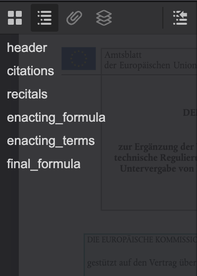

# Übergabe Parsing → Chunking

Stand der Parsing-Pipeline und das Format, in dem ihr die Dokumente für das Chunking bekommt.

## Was die Pipeline jetzt macht

Tim und ich haben die Pipeline gebaut, die ein Dokument aus `setup/downloads/` nimmt und daraus den Text Zeile für Zeile extrahiert. Der Code liegt in `backend/src/compliance_search/processing/Parsing/`.

```
setup/downloads/<document_id>.pdf
        │  main.py
        ▼
parse_pdf    → Fragmente (Wörter mit Position, Schrift usw.)
        ▼
build_lines  → Zeilen
        ▼
save_json    → ParsedDocuments/parsed_document.json
```

1. **`main.py`**: Hier beginnt die Pipeline. Stand jetzt wird ein Dokument fest ausgewählt: `SOURCE_PDF = …/setup/downloads/32025R0532_DE.pdf`. Später werden hier alle PDFs aus `setup/downloads/` durchlaufen. Danach werden die drei Funktionen der Reihe nach aufgerufen: `parse_pdf` → `build_lines` → `save_json`.
2. **`parse_pdf`**: Das Dokument wird Seite für Seite gelesen. Jedes einzelne Wort (bzw. Fragment) wird mit seinen x- und y-Werten, Schriftart, Schriftgröße und Fettdruck gespeichert.
3. **`build_lines`**: Alle Wörter/Fragmente werden nach Seite und von oben nach unten sortiert. Dann werden die einzelnen Textzeilen ermittelt, indem Wörter mit ähnlicher y-Koordinate zusammengefasst werden (Abstand höchstens die halbe Schriftgröße). Innerhalb einer Zeile stehen die Wörter von links nach rechts, mehrfache Leerzeichen und Tabs werden zu einem Leerzeichen zusammengefasst. Am Ende entsteht eine Liste aus Zeilen.
4. **`save_json`**: Diese Liste wird als JSON in `ParsedDocuments/parsed_document.json` gespeichert.

Eine Zeile sieht im Moment so aus:

```json
{ "page_number": 1, "line_number": 1, "x": 85.0393, "y": 795.345,
  "font": "/EUAlbertina-Regu", "font_size": 9.5955, "bold": false,
  "text": "Amtsblatt DE" }
```

## Was noch fehlt (Aufgabe von Tim und mir)

Die Zeilen müssen noch in grobe Blöcke (Sektionen) aufgeteilt werden. Vorher werden die Texte bereinigt (z. B. Kopf- und Fußzeilen der Seiten entfernen).

Alle Dokumente lassen sich auf der ersten Ebene in grobe Sektionen aufteilen, wenn man sie nach ihrem `doc_type` gruppiert. Davon gibt es 6 Stück, der Wert kommt direkt aus dem JSON der API. Jedes Dokument einer Gruppe lässt sich dann in die gleichen Sektionen aufteilen. Die Analyse dazu steht in [`doc-type-structure/doc_type_analysis.md`](doc-type-structure/doc_type_analysis.md): dort gibt es für jeden `doc_type` eine Tabelle mit seinen Sektionen.

## Übergabeformat an euch

Ihr bekommt jedes Dokument als zwei Listen, beschrieben in `backend/src/compliance_search/processing/sections.py` (genaue Dokumentation in der Datei):

- `<document_id>.sections.jsonl`: ein `Section`-Objekt pro Zeile
- `<document_id>.lines.jsonl`: ein `SectionLine`-Objekt pro Zeile

```python
class Section(BaseModel):
    section_id: str      # <document_id>#<seq>
    document_id: str
    seq: int             # Reihenfolge im Dokument, ab 0
    section_type: SectionType
    heading: str         # Startphrase der Sektion
    page_start: int
    page_end: int
    parser_version: str


class SectionLine(BaseModel):
    section_id: str      # Sektion, zu der die Zeile gehört
    seq: int             # wie vielte Zeile auf der Seite
    page_number: int
    font_size: float     # echte Schriftgröße auf der Seite in Punkt
    font: str
    bold: bool
    x: float             # Abstand des linkesten Zeichens vom linken Seitenrand in Punkt
    y: float             # Abstand der Grundlinie des Textes vom unteren Seitenrand in Punkt
    text: str
```

Da jede Zeile über `section_id` auf ihre Sektion verweist, könnt ihr die Zeilen den Sektionen zuordnen. Innerhalb einer Seite ergibt `seq` die Reihenfolge der Zeilen. Weil y vom unteren Rand gemessen wird, steht eine Zeile mit größerem y weiter oben.

## Euer nächster Schritt: Zeilen zu Chunks zusammenführen

Bitte lest dafür zuerst die Analyse in [`doc-type-structure/README.md`](doc-type-structure/README.md). Dort sind für alle `doc_type`s die einzelnen Parsing-Ebenen definiert. Die 1. Ebene (Sektionen) ist von uns abgeschlossen.

## Sektionen im PDF ansehen

Unter [`labeled-pdfs/`](labeled-pdfs/) liegen die PDFs mit farblich markierten Sektionen, ein Unterordner pro `doc_type`. Über diesen Reiter im PDF-Viewer könnt ihr die einzelnen Sektionen eines PDFs ansehen:


